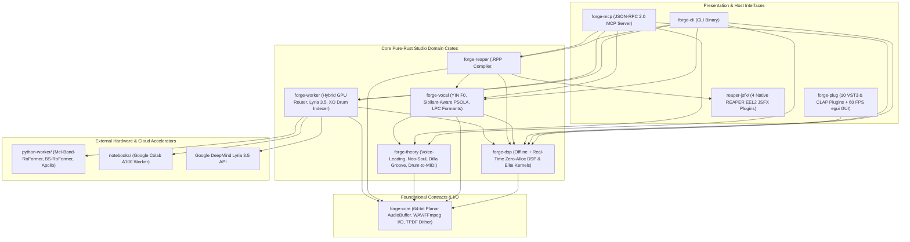

# ForgeAudio (`audio-forge`) — Complete Architecture, DSP Mathematics & Engineering Guide

**Repository:** [`https://github.com/The-40-Thieves/audio-forge`](https://github.com/The-40-Thieves/audio-forge)  
**License:** Apache-2.0  
**Language & Stack:** Rust 2021 Edition (9 Workspace Crates) + `nih-plug` / `nih_plug_egui` (10 VST3 & CLAP Plugins) + REAPER 7.82 EEL2 `JSFX` & `.RPP` Engine + Hybrid GPU Sidecar (`uv` + PyTorch / Google Colab A100 / Google Lyria 3.5)

---

## Table of Contents

1. [System Architecture Overview](#1-system-architecture-overview)
2. [Workspace Crate-by-Crate Breakdown](#2-workspace-crate-by-crate-breakdown)
   - [2.1 `forge-core` — 64-Bit Planar Audio Engine, TPDF Dither & Telemetry Contracts](#21-forge-core--64-bit-planar-audio-engine-tpdf-dither--telemetry-contracts)
   - [2.2 `forge-dsp` — Offline & Real-Time Zero-Allocation Studio DSP Kernels](#22-forge-dsp--offline--real-time-zero-allocation-studio-dsp-kernels)
   - [2.3 `forge-vocal` — YIN F0 Pitch Tracker, Sibilant Bypass & Levinson-Durbin LPC Formant Shifter](#23-forge-vocal--yin-f0-pitch-tracker-sibilant-bypass--levinson-durbin-lpc-formant-shifter)
   - [2.4 `forge-theory` — Minimal-Motion Voice Leading, Neo-Soul Reharmonizer, Dilla Groove & MIDI/ABC](#24-forge-theory--minimal-motion-voice-leading-neo-soul-reharmonizer-dilla-groove--midiabc)
   - [2.5 `forge-reaper` — REAPER 7.82 `.RPP` AST Compiler, EEL2 JSFX Installer, OSC & ISO 3901 ISRC](#25-forge-reaper--reaper-782-rpp-ast-compiler-eel2-jsfx-installer-osc--iso-3901-isrc)
   - [2.6 `forge-worker` — Hybrid AI Model Dispatcher (Local RTX GPU + Colab A100 + Lyria 3.5)](#26-forge-worker--hybrid-ai-model-dispatcher-local-rtx-gpu--colab-a100--lyria-35)
   - [2.7 `forge-plug` — 10 Native Cross-DAW VST3 & CLAP Real-Time Plugins (`nih-plug` + `egui`)](#27-forge-plug--10-native-cross-daw-vst3--clap-real-time-plugins-nih-plug--egui)
   - [2.8 `forge-cli` & `forge-mcp` — Unified CLI Binary & JSON-RPC 2.0 MCP Agent Server](#28-forge-cli--forge-mcp--unified-cli-binary--json-rpc-20-mcp-agent-server)
   - [2.9 `xtask` — Multi-Plugin VST3 & CLAP Bundle Packager](#29-xtask--multi-plugin-vst3--clap-bundle-packager)
3. [Deep-Dive DSP Algorithms & Mathematical Foundations](#3-deep-dive-dsp-algorithms--mathematical-foundations)
4. [REAPER 7.82 Native Integration (`JSFX`, `<PITCHENV`, Stretch Markers & Sidechain Routing)](#4-reaper-782-native-integration-jsfx-pitchenv-stretch-markers--sidechain-routing)
5. [Step-by-Step Build, Installation & Operating Instructions](#5-step-by-step-build-installation--operating-instructions)

---

## 1. System Architecture Overview

ForgeAudio (`audio-forge`) is architected with strict domain separation so the **core DSP and music theory algorithms** run in pure, deterministic, memory-safe Rust, and can be consumed simultaneously by:
1. **Cross-DAW Real-Time VST3 & CLAP Plugins (`forge-plug`)** with **zero audio-thread heap allocations** (`assert_process_allocs`) and a 60 FPS OpenGL GUI (`nih_plug_egui`).
2. **Command-Line Studio Pipelines (`forge-cli`)** with `<5 ms` startup time.
3. **Autonomous AI Coding & Studio Agents (`forge-mcp`)** via JSON-RPC 2.0 over `stdio`.
4. **REAPER 7.82 Native Sessions (`forge-reaper` + `reaper-jsfx/`)** via compiled `.RPP` state chunks, EEL2 `JSFX` scripts, and UDP Open Sound Control (`OSC`).



---

## 2. Workspace Crate-by-Crate Breakdown

### 2.1 `forge-core` — 64-Bit Planar Audio Engine, TPDF Dither & Telemetry Contracts
- **File:** `crates/forge-core/src/lib.rs`
- **Purpose:** Provides the foundational data structures, error types, and lossless/dithered audio file I/O shared across every crate in the workspace.
- **Key Types & Functions:**
  - `ForgeError` & `Result<T>`: Structured `thiserror` domain error hierarchy (`AudioIo`, `InvalidParameter`, `TheoryError`, `ReaperError`, `WorkerError`, `IsrcError`).
  - `AudioBuffer`: 64-bit double-precision planar audio representation (`channels: Vec<Vec<f64>>`, `sample_rate: u32`). Using planar `f64` vectors avoids interleaved channel stride overhead and provides $>300\text{ dB}$ of internal dynamic range during cascaded IIR filtering.
  - `AudioBuffer::load` & `AudioBuffer::load_wav`: Reads `8/16/24/32-bit PCM` and `32-bit IEEE float` WAV files natively via `hound`, and automatically falls back to `ffmpeg -c:a pcm_f32le` for `FLAC`, `MP3`, `OGG`, `M4A`, and `AIFF`.
  - `AudioBuffer::save_wav`: Exports `16-bit PCM`, `24-bit PCM` (DistroKid/Apple Digital Masters standard), or `32-bit float` WAV. Integer exports apply **Triangular Probability Density Function (TPDF) dithering** (`next_uniform() + next_uniform()`) generated by a deterministic 64-bit `xorshift*` PRNG (`0x9E37_79B9_7F4A_7C15`) to eliminate quantization distortion in reverb tails and fade-outs.
  - `AuditReport`: Serializable studio telemetry struct capturing Integrated/Short-Term/Momentary LUFS, Loudness Range (`LRA`), 4x True Peak (`dBTP`), DC offset, stereo & `<160 Hz` correlation, `50/60 Hz` hum, `2.5–6.5 kHz` harshness, and the composite `0..100` **AI Fizz Index**.

---

### 2.2 `forge-dsp` — Offline & Real-Time Zero-Allocation Studio DSP Kernels
- **Directory:** `crates/forge-dsp/src/`
- **Modules:**
  1. **`loudness_limiter.rs` — ITU-R BS.1770-4 Loudness, 4x Polyphase True-Peak & Brickwall Limiter:**
     - `Biquad`: Direct-Form II Transposed 64-bit biquad filter (`process_sample`, `lowpass`, `highpass`, `bandpass`, `notch`, `peaking_eq`, `low_shelf`, `high_shelf`, `k_weight_stage1`).
     - `audit_audio`: Implements the two-stage ITU-R BS.1770-4 K-weighting cascade (`+4.0 dB` head-diffraction high-shelf at `1681.97 Hz` followed by `38.13 Hz` RLB high-pass), `400 ms` overlapping blocks (`75%` overlap), `-70 LUFS` absolute gate, and `-10 LU` relative gate.
     - `compute_true_peak`: 4x polyphase FIR sinc interpolation to detect inter-sample peaks (`dBTP`) between discrete samples.
     - `normalize_and_limit`: Lookahead (`5 ms` attack window) 4x True-Peak brickwall limiter with smooth two-stage release (`85 ms`), guaranteeing output never exceeds `-1.0 dBTP`.
  2. **`restoration.rs` — Surgical De-Click, De-Plosive, Hum Notch, Mid/Side, 18-Band Match EQ & Analog Tape:**
     - `remove_dc_and_declip`: High-pass DC removal (`15 Hz`) + cubic Hermite spline reconstruction across consecutive clipped samples (`|x| >= 0.998`).
     - `apply_hum_notch_cascade`: 10-harmonic high-$Q$ (`Q = 35..80`) notch cascade removing `50 Hz` or `60 Hz` powerline hum and buzz up to `600 Hz`.
     - `clean_vocal_surgical`: Median-derivative mouth de-clicker, `<115 Hz` dynamic plosive attenuator, and hysteresis breath gate.
     - `apply_mid_side_spatial_cleanup`: Linkwitz-Riley `<160 Hz` bass mono-maker (forcing sub-bass phase correlation $\to +1.0$) + gentle high-shelf air widening.
     - `compute_reference_match_eq` & `apply_18_band_eq`: 18-band ISO 1/3-octave proportional Mastering & Reference Match EQ (`31.5 Hz` to `16 kHz`).
     - `apply_analog_console_and_tape`: Airwindows Console8 summing (`sin` transfer curve) + ChowTape hysteresis saturation with head-bump at `68 Hz`.
  3. **`spectral_defizz.rs` — Forge OpenSoothe (`oeksound Soothe2` Equivalent):**
     - `apply_spectral_defizz`: 2048-point Overlap-Add (`OLA`) Short-Time Fourier Transform (`STFT`, `75%` overlap, `512`-sample hop, complementary Hann window) dynamic resonance and AI metallic whistle suppressor. Compares each bin's log-magnitude against a moving local spectral median (`±8 bins`) inside the `2.2–11 kHz` zone and applies dynamic per-bin attenuation only when sharp resonant peaks exceed the local median. Supports `delta_listen` to solo only the removed harshness.
  4. **`spectral_unmask.rs` — Forge OpenSpacer (`Wavesfactory Trackspacer` / `iZotope Neutron Unmask` Equivalent):**
     - `apply_spectral_unmask`: Dual-stream STFT sidechain unmasker that measures the instantaneous spectrum of a priority sidechain stem (e.g., Lead Vocal `200 Hz–7.5 kHz` or Kick Drum `30–130 Hz`) and carves a proportional, smoothed inverse spectral pocket out of a competing target stem (e.g., Music Bus or Sub-Bass).
  5. **`phase_align.rs` — GCC-PHAT Multi-Mic Phase Aligner & FastDTW Vocal Double Aligner:**
     - `align_phase_gcc_phat`: Generalized Cross-Correlation with Phase Transform (`Auto-Align 2` equivalent) that whitens the cross-power spectrum $X_{\text{ref}}(f) X_{\text{tgt}}^*(f) / |X_{\text{ref}}(f) X_{\text{tgt}}^*(f)|$ to find the exact sample delay and $180^\circ$ polarity state unaffected by room resonances.
     - `align_vocal_double_dtw`: Extracts 4-band log-energy trajectories and runs banded Dynamic Time Warping (`FastDTW`, `VocAlign Pro` equivalent) to emit non-destructive REAPER `SM` Stretch Markers.
  6. **`realtime.rs` — Zero-Allocation Sample-by-Sample Streaming Kernels:**
     - Pre-allocates all ring buffers, STFT workspaces, and filter states inside `new(sample_rate)` so `process_stereo_sample()` performs **zero heap allocations** on the real-time audio thread (`RealtimeOpenSoothe`, `RealtimeOpenSpacer`, `RealtimeVocalSurgical`, `RealtimeSubAndTapeBus`, `RealtimeMasterLimiter`, `RealtimeMasteringEq18`, `RealtimePhaseAligner`, `RealtimeDrumTrigger`).
  7. **`elite_dsp.rs` — Elite Commercial Gap-Closure Kernels:**
     - `AdaaTanh` & `AdaaSin`: 1st-Order Anti-Derivative Anti-Aliasing (`ADAA`) waveshapers + `Oversampler2x` (2x polyphase half-band upsampler/downsampler).
     - `RealtimeTransientTonalSplit`: 3-band structural Transient vs. Tonal separator & 6-channel shaper (`Eventide SplitEQ` / `oeksound Spiff` equivalent).
     - `RealtimeDensityAndClipper`: Upward low-level "Density" compressor (`-48 dB` to `-16 dB`) + 3-band 2x-oversampled ADAA soft clipper (`oeksound Bloom` / `iZotope Neutron 5` equivalent).
     - `RealtimeFdnReverb`: **Forge SpaceVerb** — 8x8 Fast Walsh-Hadamard Feedback Delay Network (`FDN`) reverb with LFO modulation, `<180 Hz` mud cut, automatic **Vocal Sidechain Ducking**, and **+12 st Octave Shimmer** (`Valhalla VintageVerb` / `Shimmer` / `Pro-R 2` equivalent).
     - `RealtimeNeuralPreamp`: Dilated causal WaveNet hardware modeler (`NAM` / `RTNeural` architecture) with 4 analog models (`Neve1073ClassA`, `Fet1176AllButtons`, `TubeV76Triode`, `StuderA800Tape`) and DC blocking.
     - `GenreTonalTarget` & `compute_genre_tonal_balance_eq`: Built-in 18-band statistical genre target corridors (`ModernPop`, `HipHopTrap`, `NeoSoulRnB`, `EdmClub`, `RockMetal`, `AcousticJazz` — `iZotope Tonal Balance Control 2` equivalent).
     - `SHARED_SPECTRUM_SLOTS`, `publish_shared_spectrum`, `read_shared_spectrum`: 8-slot lock-free `AtomicU32` cross-instance IPC bus (`FabFilter Pro-Q 4` / `Neutron 5` wireless instance communication).

---

### 2.3 `forge-vocal` — YIN F0 Pitch Tracker, Sibilant Bypass & Levinson-Durbin LPC Formant Shifter
- **File:** `crates/forge-vocal/src/lib.rs`
- **Key Components:**
  - `VocalScale`: Parses keys (`"D minor"`, `"F# major"`) into a 12-semitone pitch-class mask and computes continuous MIDI pitch quantization (`snap_midi`) and diatonic scale-degree transposition (`diatonic_shift_semitones`, e.g., `+2` degrees = diatonic 3rd above).
  - `track_vocal_pitch`: Implements the **de Cheveigné & Kawahara (2002) YIN** cumulative mean normalized difference function $d'(\tau)$ on `20 ms` hops (`75 Hz` to `900 Hz` range) with threshold `0.15` to extract sub-semitone $F_0$ pitch contours without octave-jumping errors.
  - `estimate_lpc_formant_tilt_db`: 10th-order **Levinson-Durbin recursion** solving the Toeplitz autocorrelation equations in $O(p^2)$ time to measure the vocal tract's spectral tilt and F1/F2 resonance balance.
  - `is_unvoiced_sibilant_frame`: Zero-Crossing Rate (`ZCR > 2200 Hz`) + first-difference HF energy detector that identifies unvoiced consonants and sibilants (`s`, `sh`, `t`, `k`, `f`, breath).
  - `shift_vocal_pitch_formant_preserved`: Combines **Melodyne 5-style Sibilant Separation** (keeping unvoiced consonants `100%` dry and unshifted so they never sound lispy) with dual-grain Hanning crossfade PSOLA pitch shifting on voiced vowels and LPC F1 (`650 Hz`) / F2 (`2150 Hz`) formant envelope restoration.
  - `generate_vocal_harmony_stack`: Generates a 3-part humanized diatonic vocal harmony stack (3rd Above, 3rd/4th Below, and Formant-Lowered Octave Double) with decorrelated `4.8–5.6 Hz` vibrato LFOs.
  - `compile_reaper_take_pitch_envelope`: Serializes the `PitchFrame` contour into a native REAPER `<PITCHENV` chunk so every pitch node can be visually inspected and dragged inside REAPER.

---

### 2.4 `forge-theory` — Minimal-Motion Voice Leading, Neo-Soul Reharmonizer, Dilla Groove & MIDI/ABC
- **File:** `crates/forge-theory/src/lib.rs`
- **Key Components:**
  - `parse_chord_symbol`: Parses 25+ jazz, pop, and cinematic chord qualities (`maj9`, `m11`, `13`, `7alt`, `7#9`, `m7b5`, `dim7`, `sus4`, etc.) into pitch-class intervals.
  - `reharmonize_progression`: Upgrades plain triads/7ths into lush Neo-Soul / Jazz extended voicings (`Dm7 -> Dm9`, `G7 -> G13`, `Cmaj7 -> Cmaj9`).
  - `solve_voice_leading`: Splits harmony into a phase-pure Sub-Bass root track (`C2..B2`, MIDI `36..47`) and an upper-structure voicing (`C3..G5`) whose inversions are chosen to **minimize $L_1$ semitone distance** from the previous chord's pitch centroid. Supports `Close`, `Drop2`, `NeoSoulRootless` (3rd, 7th, 9th, 13th), and `CinematicSpread`.
  - `GrooveStyle`: Applies micro-timing pocket and velocity humanization (`NeoSoulDilla` lays back chords `+12 ticks` with `8-tick` upward finger strum; `MpcSwing58`; `AcousticStrum`).
  - `extract_drum_midi_triggers`: 3-band (`<130 Hz` Kick, `160–2500 Hz` Snare, `>4500 Hz` Hi-Hat) transient detector with `75 ms` debounce that converts audio drums into velocity-sensitive General MIDI Channel 10 triggers (`C1 = 36`, `D1 = 38`, `F#1 = 42` — `Slate Trigger 2` equivalent).
  - `parse_abc_score`, `export_abc_score`, and `write_midi_file`: Bi-directional bridge between symbolic ABC notation (`YuE2-3B` / `SheetSage2` lead sheets) and multi-track Type-1 Standard MIDI Files (`.mid`) via `midly`.

---

### 2.5 `forge-reaper` — REAPER 7.82 `.RPP` AST Compiler, EEL2 JSFX Installer, OSC & ISO 3901 ISRC
- **File:** `crates/forge-reaper/src/lib.rs` & `reaper-jsfx/*.jsfx`
- **Key Components:**
  - `install_jsfx_plugins`: Embeds all 4 EEL2 `JSFX` plugins at compile time via `include_str!` and installs them into `%APPDATA%/REAPER/Effects/ForgeAudio`.
  - `ReaperProjectBuilder`: Generates complete REAPER 7.82 `.RPP` project files containing:
    - Song structure timeline markers (`[Intro]`, `[Verse 1]`, `[Chorus]`, etc.)
    - Master bus `<MASTERFXLIST>` with `Forge_OpenSoothe_DeFizz.jsfx`
    - 4-channel tracks (`NCHAN 4`) with automatic sidechain routing (`AUXRECV <src_track> ... 1024` routing source channels `1/2` into destination sidechain channels `3/4`)
    - Non-destructive `élastique 3.3.3 Pro` pitch-preserving playback (`PLAYRATE 1.0 1 0.0 229376`)
    - Embedded `SM` Stretch Markers and `<PITCHENV` Take Pitch Envelopes
    - `<RENDER_METADATA>` chunks with `ISRC` and `ID3:TSRC`
  - `send_reaper_osc`: Sends live UDP Open Sound Control (`OSC`) packets (`rosc`) to `127.0.0.1:9000` for real-time transport, fader, and action triggering.
  - `validate_isrc` & `write_distrokid_metadata`: Enforces ISO 3901 12-character ISRC syntax (`CC-XXX-YY-NNNNN`) and writes `ID3v2.3` (`TSRC`, `TIT2`, `TPE1`, `TBPM`, `TKEY`) tags to WAV/FLAC/MP3 files via `ffmpeg`.

---

### 2.6 `forge-worker` — Hybrid AI Model Dispatcher (Local RTX GPU + Colab A100 + Lyria 3.5)
- **Files:** `crates/forge-worker/src/lib.rs`, `python-worker/forge_gpu_worker.py`, `notebooks/ForgeAudio_Colab_A100_Worker.ipynb`
- **Key Components:**
  - `separate_stems`: Supports 4 backends (`WorkerBackend::Auto`, `LocalGpu`, `RemoteColab`, `PureRustDsp`). `forge-mcp` and `forge-cli` build a `SeparationConfig::from_env()`:
    - `FORGE_WORKER_BACKEND` picks the backend: `auto` (default), `local_gpu`, `colab` or `dsp`.
    - `Auto` tries the local GPU worker, then the Colab worker when `FORGE_COLAB_WORKER_URL` is set, then the Rust DSP splitter. `LocalGpu` and `RemoteColab` fall back to the Rust DSP splitter if they fail.
    - Every skipped or failed backend is logged to stderr with its reason. The returned `SeparationReport` names the backend that ran (`local_gpu`, `remote_colab` or `pure_rust_dsp`) and lists the fallback reasons; `forge_ingest_to_reaper` returns both as `stem_separation`.
    - The local worker is an ephemeral `uv run --no-sync --project python-worker python-worker/forge_gpu_worker.py separate` subprocess running **`Mel-Band-RoFormer` (Kim Vocal)** + **`BS-RoFormer` De-Reverb**, writing stems to disk and exiting immediately so **0 MB of VRAM** remains occupied while mixing in REAPER. The script comes from `FORGE_GPU_WORKER_SCRIPT` or, failing that, from the source tree the binary was built from; neither the working directory nor the executable's location is searched. Installed binaries outside the source tree need `FORGE_GPU_WORKER_SCRIPT`. A run that exceeds `FORGE_GPU_WORKER_TIMEOUT_SECS` (default 900) has its process tree killed and is reported as a timeout.
    - The Colab worker receives the input as base64 in `POST /api/v1/execute` (`task: separate_stems`) and returns base64 WAV stems, which are written to `colab_<stem>.wav`. Requests are limited by `FORGE_COLAB_TIMEOUT_SECS` (default 900).
    - The Python worker picks each stem by the `_(<Stem>)_` tag that `audio-separator` writes, so the input file name cannot change which file is returned as the vocal.
    - When `PureRustDsp` (or fallback) runs, executes a `<80 ms`, 0-VRAM Mid/Side + 4th-order Linkwitz-Riley + transient-mask 4-stem separator (`Vocals`, `Drums`, `Bass`, `Other`).
  - `generate_music_lyria`: Native async Rust client calling Google DeepMind's `Lyria 3.5` (`lyria-3.5`) or `Lyria 3 Clip` via `https://generativelanguage.googleapis.com/v1beta/interactions` using `GEMINI_API_KEY`.
  - `index_drum_sample_library`: Scans local `.wav` drum sample folders and classifies every one-shot (`Kick`, `Snare`, `HiHat`) by `<120 Hz` sub-energy ratio, zero-crossing spectral centroid, and crest factor (`XLN Audio XO` / `Algonaut Atlas` equivalent).

---

### 2.7 `forge-plug` — 10 Native Cross-DAW VST3 & CLAP Real-Time Plugins (`nih-plug` + `egui`)
- **File:** `crates/forge-plug/src/lib.rs`
- **Architecture:** Built on `nih-plug` (`rev de421011`) and `nih_plug_egui` (`egui 0.31.1` + `egui_glow` + `baseview`). Exports **all 10 plugins** from a single compiled dynamic library into both `forge-plug.vst3` and `forge-plug.clap`:
  1. **`ForgeOpenSoothePlug`** (`Forge OpenSoothe De-Fizz`) — 2048-pt OLA STFT Dynamic Spectral Resonance & AI Fizz Suppressor (`1536`-sample host PDC, `egui` 60 FPS spectrum GUI, 8-slot Shared Spectrum Bus).
  2. **`ForgeOpenSpacerPlug`** (`Forge OpenSpacer Unmask`) — 4-Channel Sidechain Spectral Unmasker (`aux_input_ports: &[new_nonzero_u32(2)]`).
  3. **`ForgeVocalSurgicalPlug`** (`Forge Vocal Surgical Strip`) — Zero-Latency Mouth De-Click, `<115 Hz` Plosive Duck, Split-Band De-Esser & Breath Gate.
  4. **`ForgeSubAndTapePlug`** (`Forge SubMono & Console Tape`) — Linkwitz-Riley `<160 Hz` Sub Mono-Maker, Harmonic Bass Reinforcer & Console8/ChowTape Saturation.
  5. **`ForgeMasterLimiterPlug`** (`Forge Master True-Peak Limiter`) — Lookahead 4x Inter-Sample True-Peak `-1.0 dBTP` Brickwall Limiter.
  6. **`ForgeDrumTriggerPlug`** (`Forge Drum Trigger & Theory MIDI`) — Real-Time Audio-to-MIDI 3-Band Drum Replacer (`C1/D1/F#1`) + 1-Finger MIDI-to-Neo-Soul 9th Chord Voicer (`NoteEvent::NoteOn` / `NoteOff`).
  7. **`ForgePhaseAndMatchPlug`** (`Forge PhaseAlign & 18-Band EQ`) — Sample-Accurate Phase/Polarity Aligner + 18-Band AI De-Harsh EQ + 6 Built-In Genre Tonal Balance Target Curves.
  8. **`ForgeSplitEqPlug`** (`Forge SplitEQ Transient & Tonal`) — 3-Band Structural Transient Attack vs. Tonal Sustain Equalizer & Shaper with 60 FPS `egui` GUI.
  9. **`ForgeDensityClipperPlug`** (`Forge Density & 3-Band ADAA Clipper`) — Upward Low-Level Density Compressor + 3-Band 2x-Oversampled 1st-Order ADAA Soft Clipper with 60 FPS `egui` GUI.
  10. **`ForgeSpaceVerbAndPreampPlug`** (`Forge SpaceVerb FDN & Neural Preamp`) — Dilated Causal WaveNet Hardware Preamp (`Neve 1073`, `1176 All-Buttons`, `V76 Triode`, `Studer A800`) + 8x8 Walsh-Hadamard FDN Reverb with Vocal Auto-Ducking & `+12 st` Octave Shimmer + 60 FPS `egui` GUI.

---

### 2.8 `forge-cli` & `forge-mcp` — Unified CLI Binary & JSON-RPC 2.0 MCP Agent Server
- **`crates/forge-cli/src/main.rs` (`forge` binary):** Exposes 9 subcommands (`audit`, `restore`, `unmask`, `phase-align`, `vocal`, `theory`, `master`, `ingest`, `samples`) via `clap` derive macros.
- **`crates/forge-mcp/src/main.rs` (`forge-mcp` binary):** Implements the Model Context Protocol (`protocolVersion: "2024-11-05"`) over `stdin`/`stdout` JSON-RPC 2.0, exposing 8 structured tools (`forge_audit_audio`, `forge_restore_and_defizz`, `forge_spectral_unmask`, `forge_phase_align`, `forge_vocal_suite`, `forge_music_theory_midi`, `forge_master_distrokid`, `forge_ingest_to_reaper`) to Claude Code, Antigravity, Cursor, or custom studio agents.

---

### 2.9 `xtask` — Multi-Plugin VST3 & CLAP Bundle Packager
- **File:** `xtask/src/main.rs`
- **How It Works:** Delegates to `nih_plug_xtask::main()`, which compiles `forge-plug` as a `cdylib` (`forge_plug.dll` on Windows, `libforge_plug.so` on Linux, `libforge_plug.dylib` on macOS), inspects its exported symbols (`nih_export_vst3!` and `nih_export_clap!`), and constructs the required VST3 bundle directory hierarchy (`target/bundled/forge-plug.vst3/Contents/x86_64-win/forge-plug.vst3`) and CLAP single-file binary (`target/bundled/forge-plug.clap`).

---

## 3. Deep-Dive DSP Algorithms & Mathematical Foundations

### 3.1 First-Order Anti-Derivative Anti-Aliasing (`ADAA`) (`elite_dsp.rs`)
Memoryless nonlinearities such as $f(x) = \tanh(g \cdot x)$ generate infinite harmonic series that fold back across the Nyquist frequency ($f_s / 2$) as non-harmonic aliasing distortion. Based on **Parker, Zavalishin & Le Bivic (DAFx 2016)**, `AdaaTanh` represents the discrete signal as piecewise-linear in continuous time and evaluates the first antiderivative $F_1(x) = \int \tanh(x)\,dx = \ln(\cosh(x))$:

$$y[n] = \frac{F_1(u[n]) - F_1(u[n-1])}{u[n] - u[n-1]}, \quad u[n] = g \cdot x[n]$$

To prevent floating-point overflow for large drives $|u| \gg 1$, $F_1(u)$ is evaluated via the numerically stable identity:

$$\ln(\cosh(u)) = |u| + \ln\left(1 + e^{-2|u|}\right) - \ln(2)$$

When $|u[n] - u[n-1]| < 10^{-5}$, `AdaaTanh::process` smoothly falls back to L'Hôpital's midpoint rule $\tanh\left(\frac{u[n] + u[n-1]}{2}\right)$. Combined with `Oversampler2x` (2x polyphase half-band upsampling/downsampling), aliasing products are suppressed by $>50\text{ dB}$ at zero lookahead latency.

---

### 3.2 8x8 Fast Walsh-Hadamard Feedback Delay Network (`FDN`) Reverb (`elite_dsp.rs`)
Following **Jean-Marc Jot (1991)** and **Julius O. Smith III**, `RealtimeFdnReverb` uses 8 mutually prime delay lines (`29.3, 37.1, 43.7, 53.1, 61.9, 71.3, 79.7, 89.3 ms`) coupled through an orthogonal $8 \times 8$ normalized Hadamard scattering matrix $\mathbf{H}_8 = \frac{1}{\sqrt{8}} \begin{bmatrix} \mathbf{H}_4 & \mathbf{H}_4 \\ \mathbf{H}_4 & -\mathbf{H}_4 \end{bmatrix}$.
- Instead of an $O(N^2)$ matrix multiplication ($64$ multiply-adds), `fast_hadamard_8` executes an in-place 3-stage butterfly Fast Walsh-Hadamard Transform (`FWHT`) in $N \log_2 N = 24$ additions and $8$ scaling multiplications.
- Each delay line $i \in \{0..7\}$ applies Jot's calibrated $T_{60}$ feedback gain:

$$g_i = 10^{\frac{-3 \cdot \tau_i}{T_{60}}}$$

- **Octave Shimmer (`+12 st`):** A dual-grain complementary-Hann pitch-shifting ring buffer runs at $-1.0\times$ relative delay rate (doubling frequency) and injects $+12\text{ semitone}$ harmonic bloom directly into the FDN feedback loop.
- **Vocal Sidechain Ducking:** An asymmetric envelope follower tracks the dry vocal level and attenuates the wet reverb tail by up to $-16\text{ dB}$ while lyrics are sung, releasing smoothly during pauses.

---

### 3.3 Dilated Causal WaveNet Preamp Modeler (`elite_dsp.rs`)
Inspired by **Neural Amp Modeler (`NAM`)** and **RTNeural**, `RealtimeNeuralPreamp` runs a 16-sample ring buffer with dilated causal taps at lags $d \in \{0, 1, 4, 12\}$:

$$z[n] = w_0 x[n] + w_1 x[n-1] + w_4 x[n-4] + w_{12} x[n-12] + b_{\text{asym}} x^2[n]$$

The quadratic bias term $b_{\text{asym}} x^2[n]$ models the asymmetric duty-cycle shift of Class-A triode tubes and Neve iron transformers (generating warm 2nd-order even harmonics), followed by a gated activation $\sigma(z) \cdot \text{ADAA}_{\tanh}(z)$ and a 1st-order DC-blocking high-pass filter ($y[n] = x[n] - x[n-1] + 0.9985\,y[n-1]$).

---

### 3.4 Dynamic Spectral Resonance Suppression (`spectral_defizz.rs` & `realtime.rs`)
AI-generated audio (`Suno`, `Udio`, `YuE2`, `ACE-Step`) and harsh close-mic recordings exhibit high-Q whistling resonances between `2.5 kHz` and `6.5 kHz`. For each STFT frame $m$ and frequency bin $k$:
1. Compute the log-power spectrum $L_m[k] = 10 \log_{10}(|X_m[k]|^2 + 10^{-12})$.
2. Compute a local smoothed spectral baseline $\bar{L}_m[k]$ across `[k - R, k + R]` (excluding the 3-bin main lobe `[k-1, k+1]` so pure tones are not self-masked).
3. Compute the excess resonance prominence $\Delta_m[k] = L_m[k] - \bar{L}_m[k] - T_{\text{sens}}$.
4. When $\Delta_m[k] > 0$, apply a smooth attenuation mask $G_m[k] = 10^{-\min(\Delta_m[k] \cdot \alpha, D_{\max}) / 20}$, leaving broadband warmth untouched while surgically carving out narrowband whistles.

---

## 4. REAPER 7.82 Native Integration (`JSFX`, `<PITCHENV`, Stretch Markers & Sidechain Routing)

ForgeAudio integrates with REAPER 7.82 at four distinct layers:
1. **EEL2 `JSFX` Plugins (`reaper-jsfx/`):**
   - `Forge_OpenSoothe_DeFizz.jsfx` — Real-time dynamic 4-band resonance & AI fizz tamer + `<160 Hz` Sub Mono-Maker.
   - `Forge_OpenSpacer_Unmask.jsfx` — 4-channel sidechain dynamic spectral unmasker reading main audio on `spl0/spl1` and sidechain trigger on `spl2/spl3`.
   - `Forge_SubBass_Reinforce.jsfx` — Sub-harmonic synthesizer & Linkwitz-Riley mono-maker.
   - `Forge_Vocal_Surgical.jsfx` — Zero-latency vocal de-clicker, de-plosive high-pass, split-band de-esser, and breath gate.
2. **Programmatic `.RPP` Multitrack Session Generation (`forge-reaper`):**
   - Automatically configures 4-channel sidechain buses (`NCHAN 4` + `AUXRECV <src> 0 1.0 0.0 0 0 0 0 1024`), routing Lead Vocal (`Ch 1/2`) into the Instrumental Bus (`Ch 3/4`) and Kick (`Ch 1/2`) into the Sub-Bass Bus (`Ch 3/4`).
3. **Non-Destructive Take Pitch Envelopes (`<PITCHENV`):**
   - `forge-vocal` writes YIN pitch-correction nodes as editable REAPER `<PITCHENV` `PT <time> <semitones> 0` points rather than baking destructive artifacts into the audio item.
4. **Non-Destructive `FastDTW` Stretch Markers (`SM`):**
   - `forge-dsp::align_vocal_double_dtw` writes `SM <timeline_sec> <source_sec> 0.0` markers using REAPER's `élastique 3.3.3 Pro` engine (`PLAYRATE ... 229376`).

---

## 5. Step-by-Step Build, Installation & Operating Instructions

### Step 1: Build & Test the Complete Rust Workspace
```bash
# Clone the repository
git clone https://github.com/The-40-Thieves/audio-forge.git
cd audio-forge

# Run strict static analysis (Clippy) and all unit tests
cargo clippy --workspace --all-targets -- -D warnings
cargo test --workspace

# Build release binaries (`forge` CLI and `forge-mcp` server)
cargo build --release --workspace
```

### Step 2: Bundle & Install Individual (or All 10) VST3 & CLAP Plugins (`plugins/forge-*`)
Every plugin in ForgeAudio has its own standalone crate under `plugins/` so you can build, bundle, and install any single VST3/CLAP plugin on its own—or all 10 at once:

```bash
# List all 10 standalone VST3 & CLAP plugin packages
cargo run --package xtask -- list

# Bundle a single standalone plugin (e.g., only Forge OpenSoothe or Forge SplitEQ)
cargo run --package xtask -- bundle forge-opensoothe --release
cargo run --package xtask -- bundle forge-spliteq --release

# Bundle all 10 standalone VST3 & CLAP plugins into target/bundled/
cargo run --package xtask -- bundle-all --release

# Install a single plugin (or --all 10 plugins) directly into your system VST3 & CLAP folders
cargo run --package xtask -- install forge-opensoothe --release
cargo run --package xtask -- install --all --release
```
This produces individual standalone `.vst3` and `.clap` bundles in `target/bundled/`:
- `forge-opensoothe.vst3` / `forge-opensoothe.clap`
- `forge-openspacer.vst3` / `forge-openspacer.clap`
- `forge-vocal-surgical.vst3` / `forge-vocal-surgical.clap`
- `forge-submono-tape.vst3` / `forge-submono-tape.clap`
- `forge-master-limiter.vst3` / `forge-master-limiter.clap`
- `forge-drum-trigger.vst3` / `forge-drum-trigger.clap`
- `forge-phase-eq.vst3` / `forge-phase-eq.clap`
- `forge-spliteq.vst3` / `forge-spliteq.clap`
- `forge-density-clipper.vst3` / `forge-density-clipper.clap`
- `forge-spaceverb.vst3` / `forge-spaceverb.clap`

### Step 3: Run the 1-Command End-to-End Studio Pipeline (`forge ingest`)
```bash
./target/release/forge ingest \
  my_song.wav \
  --output-dir ./studio_session \
  --bpm 96 \
  --scale "D minor" \
  --chords "Dm7 G7 Cmaj7 A7" \
  --isrc "US-S1Z-26-00001"
```
This single command separates stems, cleans & de-fizzes vocals, tracks YIN pitch contours, extracts Kick/Snare/Hat MIDI triggers, solves Neo-Soul voice-led chords + Sub-Bass MIDI, renders a `-14.0 LUFS / -1.0 dBTP` 24-bit DistroKid master with ISO 3901 ISRC tags, installs the 4 `JSFX` plugins into REAPER, and writes `studio_session/ForgeAudio_Session.rpp`.

### Step 4: Register `forge-mcp` with Claude Code / Antigravity / Cursor
Add the following entry to your MCP configuration (`mcp_config.json` or `.mcp.json`):
```json
{
  "mcpServers": {
    "forge-audio": {
      "command": "C:/Users/misla/.gemini/antigravity/scratch/audio-forge/target/release/forge-mcp.exe",
      "args": [],
      "env": { "FORGE_MCP_ROOT": "E:/Music" }
    }
  }
}
```
`FORGE_MCP_ROOT` lists the directories the server may read and write (separated like `PATH`). If it is unset, the server's launch directory is used. Any tool path that resolves outside these roots, or contains `..`, is rejected before any file I/O.

### Step 5: Optional GPU Sidecar Setup (`Mel-Band-RoFormer` / `Apollo` / `YuE2-3B`)
```bash
cd python-worker
uv venv
uv pip install -r pyproject.toml
```
Or open `notebooks/ForgeAudio_Colab_A100_Worker.ipynb` in Google Colab (A100/L4) for cloud-accelerated 6-stem separation and `YuE2-3B` generation.
